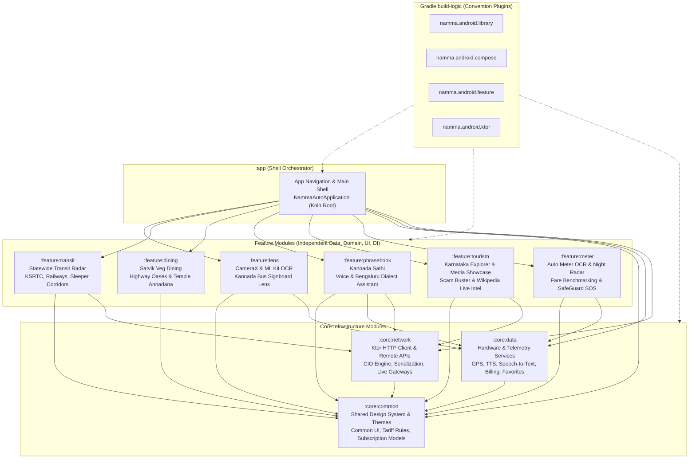
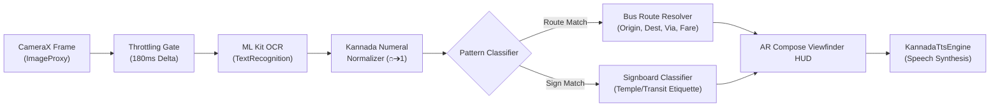

# Namma Travel Companion 🧭 (TravelCompanion / NammaAutoAI)
### *Production-Grade Multi-Module On-Device AI & Real-Time Multimodal Travel Intelligence for Android*

[](https://kotlinlang.org)
[-3DDC84.svg?style=flat&logo=android)](https://developer.android.com)
[](https://developer.android.com/jetpack/compose)
[](https://developers.google.com/ml-kit)
[](https://developer.android.com/training/camerax)
[](https://ktor.io)
[](https://insert-koin.io)
[](https://kotlinlang.org/docs/coroutines-overview.html)
[](LICENSE)

> **Architected for travelers in high-friction, low-connectivity transit environments.**  
> Built as a modern **Multi-Module Clean Architecture** Android application powered by **On-Device Computer Vision (ML Kit + CameraX)**, **Bilingual Speech & Kannada Dialect Processing**, **Ktor Networking**, **Koin Dependency Injection**, and **Custom Gradle Convention Plugins**.

---

## 🏛️ Multi-Module Architecture

The project is structured into modular layers adhering to **Clean Architecture** and **Unidirectional Data Flow (MVI/MVVM)**. Each feature module is completely independent with its own `data`, `domain`, `ui`, and `di` packages, ensuring loose coupling, fast parallel incremental builds, and high testability.



---

## 🔬 Deep Dive: Mobile AI Engineering Highlights

This project demonstrates practical mobile AI engineering patterns designed for edge devices with battery, memory, and connectivity constraints.

### 1. 📷 On-Device Computer Vision Pipeline: Kannada Bus & Signboard Lens
* **Module:** `:feature:lens` ([`BusSignLensAnalyzer.kt`](file:///home/raghunandan/StudioProjects/NammaAutoAI/feature/lens/src/main/java/com/nammaauto/ai/feature/lens/data/analyzer/BusSignLensAnalyzer.kt) & [`BusSignboardLensScreen.kt`](file:///home/raghunandan/StudioProjects/NammaAutoAI/feature/lens/src/main/java/com/nammaauto/ai/feature/lens/ui/BusSignboardLensScreen.kt))
* **The Problem:** In bus stations like Majestic (Kempegowda Bus Station), hundreds of KSRTC/BMTC buses arrive with route boards written exclusively in Kannada script (`ಬೆಂಗಳೂರು – ಧರ್ಮಸ್ಥಳ`, `ಮೈಸೂರು – ಮಡಿಕೇರಿ`). Domestic and foreign travelers cannot read destination signs, and help desks are crowded.
* **Architecture & Implementation:**
  - **CameraX 1.6.2 Pipeline:** Operates on `ImageAnalysis` with `STRATEGY_KEEP_ONLY_LATEST` to eliminate memory bloat and frame backpressure.
  - **Thermal & CPU Throttle:** Employs an adaptive 180ms inference window (~5.5 inferences/second) preventing device heating while preserving 60 FPS viewfinder fluidity.
  - **Kannada Numeral Transliteration Engine:** Deterministic parser converting Kannada numerals (`೧, ೨, ೩, ೪, ೫...`) into standard Arabic numbers (`1, 2, 3...`) in $O(N)$ time before regex evaluation.
  - **Heuristic Token Matcher:** Fuzzy regex matching for alphanumeric routes (`KIA-8`, `335-E`, `500-D`, `201-G`, `G-4`, `KSRTC MYS-EXP`) cross-referenced against an offline knowledge graph of 60+ major Karnataka routes.
  - **Temple Signage Classifier:** Automatically classifies Kannada signs (`ಪಾದರಕ್ಷೆ ಕೌಂಟರ್` ➔ Footwear, `ವಿಶೇಷ ದರ್ಶನ` ➔ Special Darshan, `ಧರ್ಮ ದರ್ಶನ` ➔ Free Darshan, `ಅಮಾನತು ಕೊಠಡಿ` ➔ Luggage Cloakroom) with safety and etiquette advice.
  - **Audio Announcer:** Hands-free speech synthesis auto-announces approaching buses in Kannada and English so travelers hear it over terminal noise.



---

### 2. 🚖 Edge Vision Meter Tampering & Integrity Radar
* **Module:** `:feature:meter` ([`AutoMeterImageAnalyzer.kt`](file:///home/raghunandan/StudioProjects/NammaAutoAI/feature/meter/src/main/java/com/nammaauto/ai/feature/meter/data/analyzer/AutoMeterImageAnalyzer.kt) & [`MeterCamScreen.kt`](file:///home/raghunandan/StudioProjects/NammaAutoAI/feature/meter/src/main/java/com/nammaauto/ai/feature/meter/ui/meter/MeterCamScreen.kt))
* **The Problem:** Auto-rickshaw meter tampering (accelerated gear pulses, uncalibrated night meters) creates significant friction and distrust for commuters.
* **Architecture & Implementation:**
  - **Real-Time Digital OCR:** Specialized regex patterns detect Indian 7-segment digital LED/LCD fares (`FARE 60`, `₹75.00`) and trip distance.
  - **Telemetry Fusion:** Fused Location Provider (`GpsTelemetryService.kt` in `:core:data`) runs concurrently, computing geodesic Haversine distance.
  - **Dynamic Integrity Engine:** Evaluates detected meter rate against government gazetted tariffs (Bengaluru Govt Tariff: ₹30 for first 1.5 km + ₹15/km thereafter; 1.5x night multiplier). Flags `FAST_METER_DETECTED` if the delta exceeds statutory thresholds.

---

### 3. 🗣️ On-Device & Bilingual Conversational Intelligence
* **Module:** `:feature:phrasebook` ([`CommuteTranslator.kt`](file:///home/raghunandan/StudioProjects/NammaAutoAI/feature/phrasebook/src/main/java/com/nammaauto/ai/feature/phrasebook/data/translator/CommuteTranslator.kt) & [`KannadaTtsEngine.kt`](file:///home/raghunandan/StudioProjects/NammaAutoAI/core/data/src/main/java/com/nammaauto/ai/data/speech/KannadaTtsEngine.kt))
* **The Problem:** Non-Kannada travelers struggle to converse with auto drivers, conductors, and local vendors under high time pressure. Traditional generic translation apps produce overly formal bookish Kannada that drivers find confusing.
* **Architecture & Implementation:**
  - **Colloquial Bengaluru Slang Lexicon:** Instant offline matching for transit idioms (e.g. *"Will you go by meter?"* ➔ *"ಮೀಟರ್ ಹಾಕಿ ಬರ್ತೀರಾ?"* / *"Meter haaki barthira?"*; *"Please put half return"* ➔ *"ಒನ್ ಅಂಡ್ ಹಾಫ್ ಆಗ್ಲಿ"*).
  - **Two-Tier Fallback:** High-probability commute phrases resolve in $0\text{ ms}$ on-device; complex arbitrary sentences fall back to asynchronous Ktor neural translation API.
  - **Phonetic Guide Generator:** Automatically emits Romanized phonetic guides with English meanings and native Lipi so users can either read phonetically or tap to speak.

---

### 4. ⚡ Statewide Multi-Modal Live Transit Radar
* **Module:** `:feature:transit` ([`StatewideTravelNavigatorScreen.kt`](file:///home/raghunandan/StudioProjects/NammaAutoAI/feature/transit/src/main/java/com/nammaauto/ai/feature/transit/ui/StatewideTravelNavigatorScreen.kt) & [`StatewideTransportModels.kt`](file:///home/raghunandan/StudioProjects/NammaAutoAI/feature/transit/src/main/java/com/nammaauto/ai/feature/transit/domain/model/StatewideTransportModels.kt))
* **The Problem:** Travel information in Karnataka is heavily fragmented across separate rail, state bus, and private aggregator portals.
* **Architecture & Implementation:**
  - **Unified Corridor Engine:** Compares State Govt Bus (KSRTC/NWKRTC), Indian Railways (SWR), and Private Sleeper fleets side-by-side for 6 major high-density corridors:
    - *Bengaluru ➔ Mysuru (145 km)*
    - *Bengaluru ➔ Hospet / Hampi (345 km)*
    - *Bengaluru ➔ Mangaluru & Udupi (360 km)*
    - *Bengaluru ➔ Madikeri / Coorg (260 km)*
    - *Bengaluru ➔ Gokarna & Murudeshwar (490 km)*
    - *Bengaluru ➔ Hubballi & Belagavi (410 km)*
  - **Live Dynamic Fare Radar:** Contrasts regular non-peak private fares vs peak holiday surge alerts (e.g., ₹750 standard vs ₹2,200 surge during Dasara).
  - **Direct GPS & Ticketing Gateways:** One-click interop with KSRTC Awatar GPS, Indian Railways NTES Live Running Status, IRCTC, and UTS Unreserved Mobile Ticketing.

---

### 5. 🌐 Hybrid Ktor Net Scraper & Offline Resilient Knowledge Graph
* **Modules:** `:core:network` & `:feature:tourism` ([`KtorTravelApiService.kt`](file:///home/raghunandan/StudioProjects/NammaAutoAI/core/network/src/main/java/com/nammaauto/ai/core/network/KtorTravelApiService.kt) & [`KarnatakaAiTripIntelligence.kt`](file:///home/raghunandan/StudioProjects/NammaAutoAI/feature/tourism/src/main/java/com/nammaauto/ai/feature/tourism/domain/model/KarnatakaAiTripIntelligence.kt))
* **The Problem:** Forest checkposts (Bandipur, Kabini) and Western Ghats treks (Kudremukh, Mullodi) have zero mobile connectivity. Online-only apps crash or show blank screens.
* **Architecture & Implementation:**
  - **Ktor 3.1.1 Engine:** Lightweight, asynchronous Ktor HTTP client with JSON serialization to scrape Wikimedia REST endpoints for real-time intel when online.
  - **Resilient Fallback Design:** Gracefully falls back to an offline structured knowledge archive when in mobile dead zones.
  - **Rule-Based Ground Truth Store:** Pre-seeded answers to critical traveler questions (e.g., Bandipur 9 PM night curfew, Kudremukh Aranya Vihaara 50-trekker cap, temple dress codes, cash-only ticket counters).

---

## 📱 Product Feature Matrix

| Module | Screen | Core Functionality | Tech Stack |
| :--- | :--- | :--- | :--- |
| `:feature:lens` | **Namma Vision Lens** | Real-time Kannada bus board, route code, and temple sign OCR with voice announcements. | CameraX + ML Kit Text Recognition + TTS |
| `:feature:meter` | **Meter Cam & Integrity Radar** | Audits digital auto meters against lawful GPS benchmarks to detect fast meters. | CameraX + ML Kit OCR + Fused Location Services |
| `:feature:transit` | **Live Transit Navigator** | Compares KSRTC Govt buses, SWR Railways (Vande Bharat/Vistadome), and Private buses. | Multi-Corridor Transit Models + NTES/Awatar Gateways |
| `:feature:phrasebook` | **Kannada Sathi** | Bilingual commute speech translator tuned for native Bengaluru auto vernacular. | Speech-to-Text + TTS + Bengaluru Slang Engine + Ktor |
| `:feature:tourism` | **Live Travel Intel** | Live Wikipedia scraper, regional climate radar, and wildlife gate closure advisories. | Ktor 3.1.1 + Serialization + Offline Cache |
| `:feature:tourism` | **Karnataka Explorer** | 100+ curated heritage, temple, and wildlife destinations with dual INR/USD pricing. | Compose M3 + Coil 3.6.3 Image Pipeline |
| `:feature:dining` | **Satvik Veg Dining** | Directory of pure vegetarian highway oases and sacred temple Annadana meal halls. | Curated Geo-Repository + 1-Tap Kannada Voice |
| `:feature:meter` | **Trip Cost Calculator** | Itemized budget estimator for transport, stay, meals, safaris, and camera permits. | Dynamic Cost Engine with Foreigner Pricing |

---

## 🛠️ Complete Technology Stack

```ini
[Platform & Language]
Kotlin = 2.4.21
Min SDK = 26 (Android 8.0 Oreo)
Compile / Target SDK = 37 (Android 17)
Java Compatibility = JDK 17

[Architecture & Build Logic]
Pattern = Clean Architecture + Multi-Module + MVI / MVVM
Build Tool = Gradle 9.7.1 + Android Gradle Plugin 9.4.1
Custom Plugins = build-logic (namma.android.library, namma.android.compose, namma.android.feature, namma.android.ktor)

[Dependency Injection]
DI Engine = Koin 4.0.2 (koin-core, koin-android, koin-androidx-compose)

[Networking]
HTTP Client = Ktor 3.1.1 (ktor-client-core, ktor-client-cio, ktor-client-content-negotiation, ktor-serialization-kotlinx-json)

[UI & Design System]
Jetpack Compose BOM = 2026.09.00
Material 3 = Yes
Icons Extended = Yes
Navigation Compose = 2.10.2
Image Loading = Coil 3.6.3 (coil-compose + coil-network-okhttp)

[Computer Vision & On-Device AI]
Google ML Kit Text Recognition = 16.0.1
CameraX (Core, Camera2, Lifecycle, View) = 1.6.2
Android TextToSpeech = Native (Locale kn_IN / en_IN)
Android SpeechRecognizer = Native (Intent-based bimodal STT)

[Hardware & Telemetry]
Google Play Services Location = 21.3.0 (FusedLocationProviderClient)
Google Play Billing = 7.1.1

[Unit Testing & Mocking]
Test Framework = JUnit 4.13.2
Mocking = MockK 1.13.16
Coroutines Testing = kotlinx-coroutines-test 1.11.0
Ktor Mock Engine = ktor-client-mock 3.1.1
```

---

## 📂 Multi-Module Source Tree

```
NammaAutoAI/
├── build-logic/                                 # Custom Gradle Convention Plugins
│   └── convention/src/main/kotlin/
│       ├── AndroidLibraryConventionPlugin.kt
│       ├── AndroidComposeConventionPlugin.kt
│       ├── AndroidFeatureConventionPlugin.kt
│       └── AndroidKtorConventionPlugin.kt
├── app/                                         # Orchestrator Application Shell
│   └── src/main/java/com/nammaauto/ai/
│       ├── NammaAutoApplication.kt              # Koin Root Modules Registration
│       └── presentation/
│           ├── MainActivity.kt                  # Edge-to-edge Compose Host
│           ├── Navigation.kt                    # NavHost routing across all features
│           └── favorites/                       # App-level favorites aggregator
├── core/
│   ├── common/                                  # Shared Utilities, Design Tokens & Domain
│   │   ├── core/theme/                          # Color, Typography, Shape, M3 Theme
│   │   ├── core/util/                           # NavigationUtils, BangaloreLocations
│   │   ├── presentation/components/             # GlassCard, HUD reticles, badges
│   │   └── domain/model/                        # BangaloreTariff, SubscriptionPlan, MeterReading
│   ├── network/                                 # Network Infrastructure with Ktor
│   │   ├── KtorTravelApiService.kt              # Wikipedia REST & Translation API client
│   │   └── di/NetworkModule.kt                  # Koin Network bindings
│   └── data/                                    # Repositories & Hardware Telemetry
│       ├── location/GpsTelemetryService.kt      # Geodesic Haversine GPS tracker
│       ├── speech/KannadaTtsEngine.kt           # Text-to-Speech synthesis engine
│       ├── speech/SpeechToTextManager.kt        # Voice speech recognition engine
│       ├── billing/BillingManager.kt            # Google Play in-app subscriptions
│       ├── repository/FavoritesManager.kt       # Persistent StateFlow bookmarks
│       └── di/CoreDataModule.kt                 # Koin Data bindings
└── feature/
    ├── lens/                                    # On-Device CameraX + ML Kit Bus Board OCR
    │   ├── data/analyzer/BusSignLensAnalyzer.kt
    │   ├── domain/model/BusSignLensModels.kt
    │   ├── ui/BusSignboardLensScreen.kt & ViewModel
    │   └── di/LensModule.kt
    ├── transit/                                 # Statewide Multi-Fleet Transit Hub
    │   ├── domain/model/StatewideTransportModels.kt
    │   ├── ui/StatewideTravelNavigatorScreen.kt
    │   └── di/TransitModule.kt
    ├── dining/                                  # Satvik Veg Dining & Annadana Directory
    │   ├── domain/model/KarnatakaVegDining.kt
    │   ├── data/repository/KarnatakaVegFoodRepository.kt
    │   ├── ui/VegFoodScreen.kt & ViewModel
    │   └── di/DiningModule.kt
    ├── phrasebook/                              # Kannada Sathi Commute Voice Translator
    │   ├── data/translator/CommuteTranslator.kt
    │   ├── domain/repository/PhrasebookRepository.kt
    │   ├── ui/KannadaSathiScreen.kt & ViewModel
    │   └── di/PhrasebookModule.kt
    ├── tourism/                                 # Heritage Explorer, Scam Buster, Intel
    │   ├── domain/repository/KarnatakaTourismRepository.kt
    │   ├── domain/model/KarnatakaAiTripIntelligence.kt & TouristScamBuster.kt
    │   ├── ui/KarnatakaExplorerScreen.kt, LiveTravelIntelScreen.kt
    │   └── di/TourismModule.kt
    └── meter/                                   # Auto Meter OCR, Night Safety & Fare Calculator
        ├── data/analyzer/AutoMeterImageAnalyzer.kt
        ├── domain/model/RidePulseEngine.kt & TravelCostEngine.kt
        ├── ui/MeterCamScreen.kt, FareEstimatorScreen.kt, NightGuardianScreen.kt
        └── di/MeterModule.kt
```

---

## 🧪 Unit Testing & Quality Verification

Every module includes dedicated unit tests verifying business logic, edge conditions, OCR normalization, and API mocking:

```bash
# Execute all unit tests across all 9 modules
./gradlew testDebugUnitTest
```

| Subproject | Test Class | Validated Behaviors |
| :--- | :--- | :--- |
| `:core:network` | `KtorTravelApiServiceTest` | Ktor mock engine responses, Wikipedia extract parsing, API failure resilience. |
| `:core:data` | `FavoritesManagerTest` | Spot and restaurant bookmarking, StateFlow emissions, idempotency. |
| `:feature:lens` | `BusSignLensAnalyzerTest` | Kannada numeral transliteration (`೧➔1`), alphanumeric route parsing (`KIA-8`, `335-E`), temple signs. |
| `:feature:transit` | `TransitCorridorTest` | High-density corridor count, peak fare calculation, operator classification. |
| `:feature:dining` | `KarnatakaVegFoodRepositoryTest` | Highway filter parsing, Annadana presence, signature dish querying. |
| `:feature:phrasebook` | `PhrasebookRepositoryTest` | High-probability slang translation, phonetic guide emission, category indexing. |
| `:feature:tourism` | `KarnatakaTourismRepositoryTest` | Regional circuit indexing (Karavali, Malnad, Deccan), foreign pricing rules. |
| `:feature:meter` | `TravelCostEngineTest` | Government gazetted tariff formula, night multiplier, distance threshold calculations. |

---

## 🚀 Building & Running

### Prerequisites
* **Android Studio Ladybug | 2024.2.1** or newer
* **JDK 17** configured as the Gradle JDK
* Android device or emulator running **API 26 (Android 8.0)** or higher

### Steps
1. Clone the repository:
   ```bash
   git clone https://github.com/<your-username>/NammaAutoAI.git
   cd NammaAutoAI
   ```
2. Open the project in Android Studio.
3. Allow Gradle to sync dependencies via `build-logic`.
4. Run the test suite:
   ```bash
   ./gradlew testDebugUnitTest
   ```
5. Deploy and run the app:
   ```bash
   ./gradlew :app:installDebug
   ```

---

## 📄 License

```
Copyright (c) 2026 Namma Travel Companion Contributors

Licensed under the Apache License, Version 2.0 (the "License");
you may not use this file except in compliance with the License.
You may obtain a copy of the License at

    http://www.apache.org/licenses/LICENSE-2.0
```
