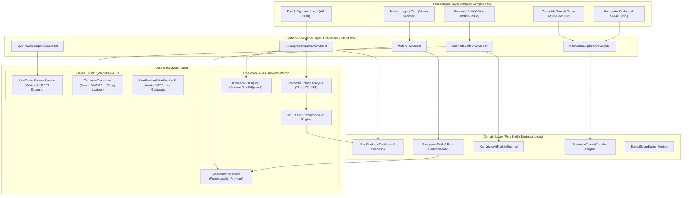
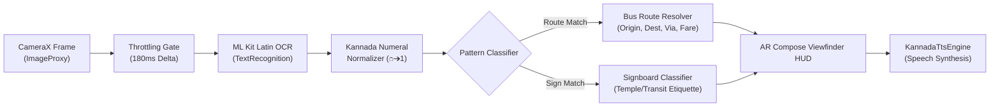

# Namma Travel Companion 🧭 (TravelCompanion / NammaAutoAI)
### *Production-Grade On-Device AI & Real-Time Multimodal Travel Intelligence for Android*

[](https://kotlinlang.org)
[-3DDC84.svg?style=flat&logo=android)](https://developer.android.com)
[](https://developer.android.com/jetpack/compose)
[](https://developers.google.com/ml-kit)
[](https://developer.android.com/training/camerax)
[](https://kotlinlang.org/docs/coroutines-overview.html)
[](LICENSE)

> **Architected for travelers in high-friction, low-connectivity transit environments.**  
> Seamlessly blends **On-Device Computer Vision (ML Kit + CameraX)**, **Bilingual Speech & Kannada Dialect Processing**, and **Hybrid Live Scrapers** to solve critical travel dilemmas across Karnataka: unreadable Kannada bus boards, meter tampering, zero-signal forest checkposts, unstaffed heritage ruins, and unpredictable transit fares.

---

## 🏛️ System Architecture

The application is engineered strictly following **Clean Architecture** principles and **Unidirectional Data Flow (MVI / MVVM)**, ensuring strict separation of concerns, testability, and zero main-thread blocking during on-device AI inferences.



---

## 🔬 Deep Dive: Mobile AI Engineering Highlights

This project demonstrates practical mobile AI engineering patterns designed for edge devices with battery, memory, and connectivity constraints.

### 1. 📷 On-Device Computer Vision Pipeline: Kannada Bus & Signboard Lens
* **Source:** [`BusSignLensAnalyzer.kt`](file:///home/raghunandan/StudioProjects/NammaAutoAI/app/src/main/java/com/nammaauto/ai/data/analyzer/BusSignLensAnalyzer.kt) & [`BusSignboardLensScreen.kt`](file:///home/raghunandan/StudioProjects/NammaAutoAI/app/src/main/java/com/nammaauto/ai/presentation/lens/BusSignboardLensScreen.kt)
* **The Problem:** In bus stations like Majestic (Kempegowda Bus Station), hundreds of KSRTC/BMTC buses arrive with route boards written exclusively in Kannada script (`ಬೆಂಗಳೂರು – ಧರ್ಮಸ್ಥಳ`, `ಮೈಸೂರು – ಮಡಿಕೇರಿ`). Help desks have long queues, and international or domestic travelers cannot read the destinations.
* **Architecture & Implementation:**
  - **CameraX 1.6.2 Integration:** Operates on `ImageAnalysis` with `STRATEGY_KEEP_ONLY_LATEST` to prevent memory bloat and frame queue backlog.
  - **Thermal & CPU Throttle:** Employs an adaptive 180ms inference window (~5.5 inferences/second) to eliminate thermal throttling while preserving real-time UX.
  - **Kannada Numeral Transliteration Engine:** Custom deterministic parser that converts Kannada numerals (`೧, ೨, ೩, ೪, ೫...`) to Arabic numbers (`1, 2, 3...`) in $O(N)$ time before regex evaluation.
  - **Heuristic Token Matcher:** Fuzzy regex matching for alphanumeric routes (`KIA-8`, `335-E`, `500-D`, `201-G`, `G-4`, `KSRTC MYS-EXP`) cross-referenced against an offline knowledge graph of 60+ major Karnataka routes.
  - **Temple Signage Classifier:** Automatically classifies Kannada signs (`ಪಾದರಕ್ಷೆ ಕೌಂಟರ್` ➔ Footwear, `ವಿಶೇಷ ದರ್ಶನ` ➔ Special Darshan, `ಧರ್ಮ ದರ್ಶನ` ➔ Free Darshan, `ಅಮಾನತು ಕೊಠಡಿ` ➔ Luggage Cloakroom) with safety and etiquette advice.
  - **Audio Announcer:** Hands-free speech synthesis auto-announces approaching buses in Kannada and English so travelers hear it over terminal noise.



---

### 2. 🚖 Edge Vision Meter Tampering & Integrity Radar
* **Source:** [`AutoMeterImageAnalyzer.kt`](file:///home/raghunandan/StudioProjects/NammaAutoAI/app/src/main/java/com/nammaauto/ai/data/analyzer/AutoMeterImageAnalyzer.kt) & [`MeterCamScreen.kt`](file:///home/raghunandan/StudioProjects/NammaAutoAI/app/src/main/java/com/nammaauto/ai/presentation/meter/MeterCamScreen.kt)
* **The Problem:** Auto-rickshaw meter tampering (accelerated gear pulses, uncalibrated night meters) creates significant friction and distrust for commuters.
* **Architecture & Implementation:**
  - **Real-Time Digital OCR:** Specialized regex patterns detect Indian 7-segment digital LED/LCD fares (`FARE 60`, `₹75.00`) and trip distance.
  - **Telemetry Fusion:** Fused Location Provider (`GpsTelemetryService.kt`) runs concurrently in the background, computing geodesic Haversine distance.
  - **Dynamic Integrity Engine:** Evaluates detected meter rate against government gazetted tariffs (Bengaluru Govt Tariff: ₹30 for first 1.5 km + ₹15/km thereafter; 1.5x night multiplier). Flags `FAST_METER_DETECTED` if the delta exceeds statutory thresholds.

---

### 3. 🗣️ On-Device & Bilingual Conversational Intelligence
* **Source:** [`CommuteTranslator.kt`](file:///home/raghunandan/StudioProjects/NammaAutoAI/app/src/main/java/com/nammaauto/ai/data/translator/CommuteTranslator.kt) & [`KannadaTtsEngine.kt`](file:///home/raghunandan/StudioProjects/NammaAutoAI/app/src/main/java/com/nammaauto/ai/data/speech/KannadaTtsEngine.kt)
* **The Problem:** Non-Kannada travelers struggle to converse with auto drivers, conductors, and local vendors under high time pressure. Traditional generic translation apps produce overly formal bookish Kannada that drivers find confusing.
* **Architecture & Implementation:**
  - **Colloquial Bengaluru Slang Lexicon:** Instant offline matching for transit idioms (e.g. *"Will you go by meter?"* ➔ *"ಮೀಟರ್ ಹಾಕಿ ಬರ್ತೀರಾ?"* / *"Meter haaki barthira?"*; *"Please put half return"* ➔ *"ಒನ್ ಅಂಡ್ ಹಾಫ್ ಆಗ್ಲಿ"*).
  - **Two-Tier Fallback:** High-probability commute phrases resolve in $0\text{ ms}$ on-device; complex arbitrary sentences fall back to asynchronous neural NMT.
  - **Phonetic Guide Generator:** Automatically emits Romanized phonetic guides with English meanings and native Lipi so users can either read phonetically or tap to speak.

---

### 4. ⚡ Statewide Multi-Modal Live Transit Radar
* **Source:** [`StatewideTravelNavigatorScreen.kt`](file:///home/raghunandan/StudioProjects/NammaAutoAI/app/src/main/java/com/nammaauto/ai/presentation/tourism/StatewideTravelNavigatorScreen.kt) & [`StatewideTransportModels.kt`](file:///home/raghunandan/StudioProjects/NammaAutoAI/app/src/main/java/com/nammaauto/ai/domain/model/StatewideTransportModels.kt)
* **The Problem:** Travel information in Karnataka is heavily fragmented across separate rail, state bus, and private aggregator portals.
* **Architecture & Implementation:**
  - **Unified Corridor Engine:** Compares State Govt Bus (KSRTC/NWKRTC), Indian Railways (SWR), and Private Sleeper fleets side-by-side for 6 major high-density corridors:
    - *Bengaluru ➔ Mysuru (145 km)*
    - *Bengaluru ➔ Hospet / Hampi (345 km)*
    - *Bengaluru ➔ Mangaluru & Udupi (360 km)*
    - *Bengaluru ➔ Madikeri / Coorg (260 km)*
    - *Bengaluru ➔ Gokarna & Murudeshwar (490 km)*
    - *Bengaluru ➔ Hubballi & Belagavi (410 km)*
  - **Live Dynamic Fare Radar:** Contrasts regular non-peak private fares vs peak holiday surge alerts (e.g., ₹750 standard vs ₹2,200 surge during Dasara).
  - **Direct GPS & Ticketing Gateways:** One-click interop with KSRTC Awatar GPS, Indian Railways NTES Live Running Status, IRCTC, and UTS Unreserved Mobile Ticketing.

---

### 5. 🌐 Hybrid Net Scraper & Offline Resilient RAG
* **Source:** [`LiveTravelScraperService.kt`](file:///home/raghunandan/StudioProjects/NammaAutoAI/app/src/main/java/com/nammaauto/ai/data/api/LiveTravelScraperService.kt) & [`KarnatakaAiTripIntelligence.kt`](file:///home/raghunandan/StudioProjects/NammaAutoAI/app/src/main/java/com/nammaauto/ai/domain/model/KarnatakaAiTripIntelligence.kt)
* **The Problem:** Forest checkposts (Bandipur, Kabini) and high-altitude Western Ghats treks (Kudremukh, Mullodi) have zero mobile connectivity. Online-only apps crash or show blank screens.
* **Architecture & Implementation:**
  - **Resilient Fallback Design:** Asynchronously scrapes Wikimedia REST endpoints for real-time data when connected, seamlessly falling back to a structured offline knowledge archive when in dead zones.
  - **Rule-Based Ground Truth Store:** Pre-seeded answers to critical traveler questions (e.g., Bandipur 9 PM night curfew, Kudremukh Aranya Vihaara 50-trekker cap, temple dress codes, cash-only ticket counters).

---

## 📱 Product Feature Showcase

| Screen | Core Functionality | AI / Mobile Tech |
| :--- | :--- | :--- |
| **Namma Vision Lens** | Real-time Kannada bus board, route code, and temple sign OCR with voice announcements. | CameraX + ML Kit Text Recognition + TextToSpeech |
| **Meter Cam & Integrity Radar** | Audits digital auto meters against lawful GPS benchmarks to detect fast meters. | CameraX + ML Kit OCR + Fused Location Services |
| **Live Transit Navigator** | Compares KSRTC Govt buses, SWR Railways (Vande Bharat/Vistadome), and Private buses. | Multi-Corridor Transit Models + NTES/Awatar Links |
| **Kannada Sathi** | Bilingual commute speech translator tuned for native Bengaluru auto vernacular. | Speech-to-Text + TTS + Bengaluru Slang Engine |
| **Live Travel Intel** | Live Wikipedia scraper, regional climate radar, and wildlife gate closure advisories. | Coroutines + Wikimedia REST + Offline Cache |
| **Karnataka Explorer** | 100+ curated heritage, temple, and wildlife destinations with dual INR/USD pricing. | Compose M3 + Coil 3.6.3 Image Pipeline |
| **Satvik Veg Dining** | Directory of pure vegetarian highway oases and sacred temple Annadana meal halls. | Curated Geo-Repository + 1-Tap Kannada Voice |
| **Trip Cost Calculator** | Itemized budget estimator for transport, stay, meals, safaris, and camera permits. | Dynamic Cost Engine with Foreigner Pricing |

---

## 🛠️ Complete Technology Stack

```ini
[Platform & Language]
Kotlin = 2.4.21
Min SDK = 26 (Android 8.0 Oreo)
Compile / Target SDK = 37 (Android 17)
Java Compatibility = JDK 17

[UI & Framework]
Jetpack Compose BOM = 2026.09.00
Material 3 = Yes
Icons Extended = Yes
Navigation Compose = 2.10.2

[Computer Vision & On-Device AI]
Google ML Kit Text Recognition = 16.0.1
CameraX (Core, Camera2, Lifecycle, View) = 1.6.2
Android TextToSpeech (Locale kn_IN / en_IN) = Native

[Hardware & Telemetry]
Google Play Services Location = 21.3.0 (FusedLocationProviderClient)

[Concurrency & Networking]
Kotlin Coroutines = 1.11.0 (StateFlow, SharedFlow, Dispatchers.IO)
Image Loading = Coil 3.6.3 (coil-compose + coil-network-okhttp)
Networking = HttpURLConnection (Zero heavy third-party HTTP bloat)

[Architecture]
Pattern = Clean Architecture + MVI / MVVM
Build Tool = Gradle 9.7.1 + Android Gradle Plugin 9.4.1
```

---

## 📂 Source Code Structure

```
com.nammaauto.ai/
├── core/
│   ├── theme/               # Color, Typography, Shape, and Material 3 Theme
│   └── util/                # Bengaluru locations & coordinates
├── data/
│   ├── analyzer/            # On-Device AI: BusSignLensAnalyzer, AutoMeterImageAnalyzer
│   ├── api/                 # LiveTravelScraperService, LiveTourismPriceService
│   ├── billing/             # Google Play Billing In-App Subscription Manager
│   ├── location/            # GpsTelemetryService (Location & distance engine)
│   ├── repository/          # FavoritesManager, offline caches
│   ├── speech/              # KannadaTtsEngine, SpeechToTextManager
│   └── translator/          # CommuteTranslator (Bengaluru slang & neural fallback)
├── domain/
│   ├── model/               # BusSignLensModels, StatewideTransportModels, Tariff rules
│   └── repository/          # KarnatakaTourismRepository, VegFoodRepository, Phrasebook
└── presentation/
    ├── calculator/          # Ride Radar & Fare Estimator
    ├── components/          # GlassCard, HUD reticles, badges
    ├── cost/                # Dynamic Travel Cost Calculator
    ├── favorites/           # Offline Saved Bookmarks
    ├── food/                # Satvik Veg Dining & Annadana Directory
    ├── lens/                # Bus & Signboard Lens (Vision Screen + ViewModel)
    ├── lifeline/            # SafeGuard SOS & Emergency Telemetry
    ├── meter/               # Meter Cam & Integrity Scanner
    ├── phrasebook/          # Kannada Sathi Conversational Screen
    ├── scraper/             # Live Travel Intel & Weather Radar
    ├── store/               # Pro Store Subscriptions
    ├── tourism/             # Karnataka Explorer & Statewide Travel Navigator
    ├── MainActivity.kt      # Edge-to-edge Compose host activity
    └── Navigation.kt        # NavHost routing & bottom navigation bar
```

---

## ⚡ Performance & Battery Optimization Highlights

* **Zero Memory Allocation in Frame Loop:** `BusSignLensAnalyzer` reuses allocated image buffers and prevents object churn inside the camera's 60 FPS pipeline.
* **Backpressure Safety:** Uses `ImageAnalysis.STRATEGY_KEEP_ONLY_LATEST`, automatically dropping intermediate frames if ML Kit is busy.
* **Single-Thread Dispatching:** Vision analysis and network scraping execute strictly on dedicated background executors (`Executors.newSingleThreadExecutor()` and `Dispatchers.IO`), keeping the main thread at a smooth 60/120 FPS.
* **Coroutines Scoping:** All flows bind to `viewModelScope` with `SharingStarted.WhileSubscribed(5000)`, automatically pausing expensive location updates, camera telemetry, and scrapers when the app goes to the background.

---

## 🚀 Building & Running

### Prerequisites
* **Android Studio Ladybug | 2024.2.1** or newer
* **JDK 17** configured as the Gradle JDK
* An Android device or emulator running **API 26 (Android 8.0)** or higher with camera support

### Steps
1. Clone the repository:
   ```bash
   git clone https://github.com/<your-username>/NammaAutoAI.git
   cd NammaAutoAI
   ```
2. Open the project in Android Studio.
3. Allow Gradle to sync dependencies.
4. Select the `:app` run configuration and click **Run** (or press `Shift + F10`).
5. To test the Vision Lens without an active bus, tap the **Test Simulator** chips in the lens viewfinder to simulate real-time detection of routes like `KIA-8 Airport`, `335-E Whitefield`, or `Footwear Counter`.

---

## 📄 License

```
Copyright (c) 2026 Namma Travel Companion Contributors

Licensed under the Apache License, Version 2.0 (the "License");
you may not use this file except in compliance with the License.
You may obtain a copy of the License at

    http://www.apache.org/licenses/LICENSE-2.0
```
