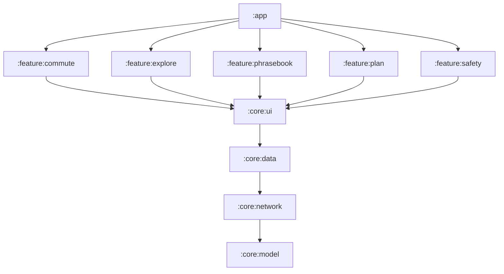

# Namma Travel Companion 🧭

### A Karnataka travel and commute app for visitors who don't read Kannada

[](https://kotlinlang.org)
[](https://developer.android.com)
[](https://developer.android.com/jetpack/compose)
[-EA4335.svg?style=flat)](https://github.com/adaptech-cz/Tesseract4Android)
[](https://developer.android.com/training/camerax)
[](https://developer.android.com/google/play/billing)
[-red.svg)](LICENSE)

Reads Kannada bus boards and temple signs out loud in English, shows what a ride *should* cost according to
the government's notified fares, measures auto rides by GPS, speaks Kannada phrases for you, and watches your
ride at night. Safety features are free, always. Everything else is free with daily limits, or unlimited after
one small one-time purchase.

---

## Architecture & Multi-Module Structure

TravelCompanion is built using a clean **Multi-Module Architecture** powered by custom Gradle convention plugins (`build-logic`), separating domain models, data sources, shared UI, and app navigation into dedicated modules.



### Module Breakdown:
- **`:buildSrc`**: Gradle plugins setup.
- **`:core:model`**: Pure Kotlin domain models, tariff structures, and data classes (independent of Android framework).
- **`:core:network`**: Ktor clients and shared networking setup.
- **`:core:data`**: Repositories, common data sources, TTS/STT.
- **`:core:ui`**: Material 3 theme (`NammaAutoAITheme`), design system components (`GlassCard`, `BangaloreBadge`), and Coil image loading integration.
- **`:feature:*`**: Vertical slices (`commute`, `explore`, `phrasebook`, `plan`, `safety`), each containing its own Domain, Data, and Presentation logic powered by Koin DI.
- **`:app`**: Application entry point, `MainActivity`, DI setup, navigation graph, and feature UI screen bindings.

---

## Features

The app has five tabs.

| Tab | Feature | What it does |
| --- | --- | --- |
| **Explore** | Districts | Tappable map of all 31 districts (south to north), each with what it is famous for; search any place |
| | District page | Every tourist place in the district, grouped: temples, waterfalls, wildlife & zoos, hills & treks, forts, heritage, lakes, beaches, theme parks…; plus **Shop & taste** (GI-tagged products like Mysore Silk, Channapatna toys, Ilkal sarees) |
| | Place page | Photo, Wikipedia intro, directions, and the author's own YouTube videos of that place |
| **Plan** | Travel Guide & Tips | Curated tickets, timings, dress codes, etiquette and scam alerts for top destinations |
| | Trip Costs | Budget for transport, stay, tickets and food for a multi-stop trip |
| | Veg Dining | Trusted darshinis, highway food stops, temple meal (annadana) etiquette |
| | Travel Intel | **Live weather** per region (Open-Meteo), Wikipedia lookup for any place, forest-gate and permit rules |
| | Photos, Saved | Destination gallery; saved places and restaurants |
| **Commute** | Official Fares | Government-notified auto (4 cities), taxi/app-cab, Namma Metro, BMTC and KSRTC fares for any distance, each with effective date and source link |
| | Meter Cam | GPS meter using the official tariff (distance, actual waiting time, night rate), or scan the auto's meter with the camera to check it |
| | Ride Fares | Estimated auto/cab fares between areas, with a fair cash offer phrase in Kannada |
| | Bus & Sign Lens | Point the camera at a bus or sign: route number, destination and temple signs read out in English and Kannada |
| | Transit Hub | KSRTC, trains and city transit across the state, with links to official booking and tracking |
| **Kannada** | Kannada Sathi | Phrasebook with voice, plus type or speak English to get Kannada |
| **Safety** | Night Guardian | Alerts (vibrating notification, works with the screen off) when the ride moves away from your drop point; one-tap SOS with your real GPS location to your chosen contact; call 112 |
| | Helplines | Police, ambulance, trauma hospitals, BTP auto complaints via WhatsApp |

**Monetisation:** one non-consumable Play product (`full_access`) removes the daily limits on meter scans
(3/day) and Kannada voice playback (5/day). No subscription, no ads. SOS, helplines, Night Guardian, official
fares and the GPS meter are never limited.

---

## Build, Test, and CI/CD

```bash
./gradlew testDebugUnitTest            # Run unit tests across all modules
./gradlew assembleDebug                # Build debug APK
./gradlew lintDebug                    # Run Android lint checks
```

* **CI/CD Pipeline**: Configured via [.gitlab-ci.yml](.gitlab-ci.yml) for automated linting, unit testing, and artifact generation on GitLab.

---

## License

**Proprietary. All rights reserved.** The source is published so the work can be reviewed; it may not be copied,
modified, built or redistributed, including to any app store, without written permission. See [LICENSE](LICENSE).
